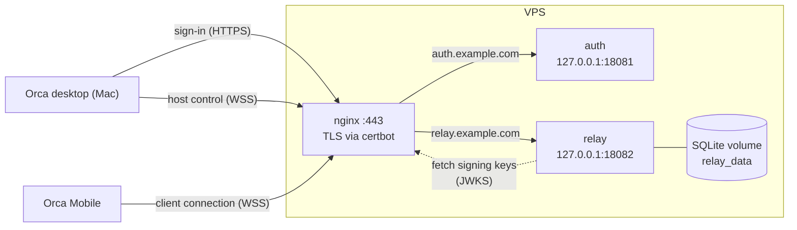
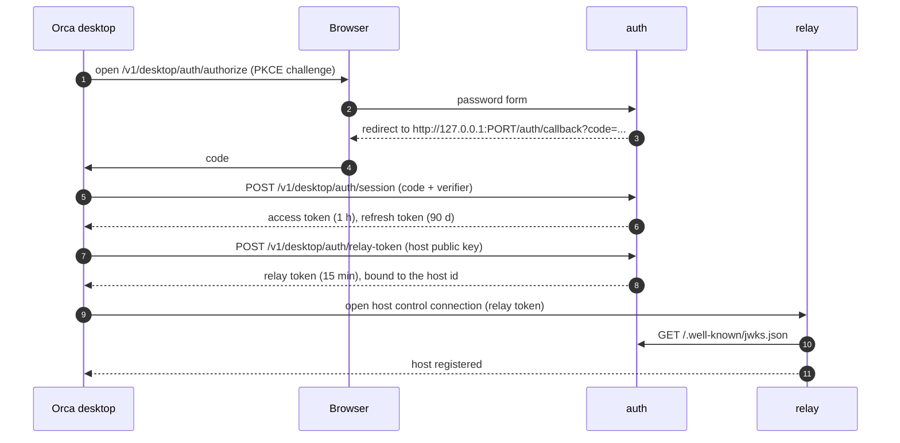
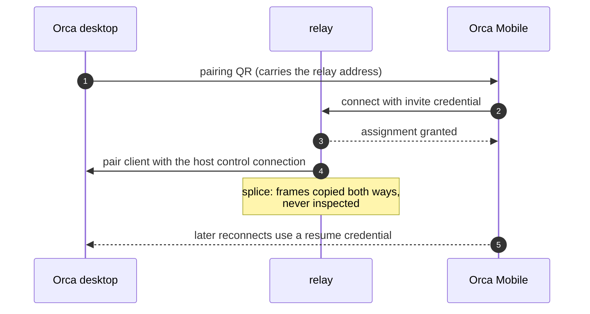

# Self-hosted Orca Mobile relay

Deployment files for running your own relay between the Orca desktop app and Orca Mobile, on
your own VPS, instead of Stably's hosted relay.

It is a thin deployment wrapper. The relay and the sign-in service are built from
[`hmseeb/orca-relay`](https://github.com/hmseeb/orca-relay), pinned to one commit, and run behind
the nginx and certbot that already exist on the host.

## Scope and caveats

- **Orca Mobile pairing only.** It does not give `orca serve` a desktop-to-VPS relay route
  (upstream issue [stablyai/orca#22278](https://github.com/stablyai/orca/issues/22278)).
- **Unofficial.** It replaces Orca Cloud's private sign-in with a single-user stand-in and relies
  on undocumented desktop interfaces. An Orca update can break it.
- **Single account.** One password, one identity. Every desktop you sign in shares it.
- **Push notifications** still go through Stably's gateway.

## Architecture



| Component | Role |
|---|---|
| nginx + certbot | Existing host services. Terminate TLS and route by hostname. Not run by this repo's compose file. |
| `auth` | Single-user stand-in for Orca Cloud sign-in. Password page, PKCE code exchange, access and refresh tokens, and ES256 relay tokens. No dependencies. |
| `relay` | Upstream Orca relay in `combined` mode (director and cell in one process), SQLite on a Docker volume. Pairs a host connection with a client connection and forwards frames between them. |

Both containers publish to `127.0.0.1` only. nginx is the only public entry point.

## How it works

### Sign-in and relay token



The auth service only redirects codes to the desktop's own loopback callback. Codes are single
use and expire after 5 minutes. A relay token is bound to a host id derived from the host's
public key, and expires after 15 minutes.

### Pairing and traffic



The relay's forwarding code copies frames between the two sockets without reading them. The
encryption between phone and desktop is done by the Orca apps themselves. This repo does not
verify it.

## Requirements

- A Linux VPS with Docker (Compose v2), nginx, certbot with the nginx plugin, `envsubst`, and
  ports 80 and 443 reachable (cloud security group and OS firewall).
- Two DNS A records to the VPS, for example `auth.example.com` and `relay.example.com`, with no
  CDN or proxy in front.
- Region: a Hong Kong or Singapore VPS avoids the problems a mainland China VPS has with Docker
  Hub and GitHub (the build pulls `node:24-alpine`, clones GitHub and runs `pnpm install`).
  A domain on ports 80/443 in mainland China also needs an ICP filing.
- On the Mac: the Orca desktop app. The launcher script is macOS only.

nginx can keep serving other sites. This setup adds one file, `orca-relay.conf`, and touches no
other vhost.

## Deploy

All commands run on the VPS, from this repo's directory.

1. **DNS.** Create the two A records and wait until both resolve to the VPS.
   If you use DomaiNesia, DNS Management only takes effect when the domain uses their default
   nameservers.

2. **Generate secrets.**

   ```sh
   scripts/init-env.sh auth.example.com relay.example.com
   ```

   Writes `.env` (mode 600) with a fresh password, signing key, and relay assignment key.
   Nothing is printed. Refuses to overwrite an existing `.env`.

3. **Build and start.**

   ```sh
   docker compose up -d --build
   ```

   The first build takes roughly 15 minutes on a small VPS because the relay image runs
   `pnpm install`. Run it with `nice -n 15` on a shared host.

4. **Add the nginx vhosts.**

   ```sh
   scripts/install-nginx.sh
   ```

   Substitutes domains and ports into `deploy/nginx.conf.template`, installs it as
   `/etc/nginx/sites-available/orca-relay.conf`, runs `nginx -t`, and reloads. If the test
   fails it removes the vhost and does not reload.

5. **Issue certificates.**

   ```sh
   sudo certbot --nginx -d auth.example.com -d relay.example.com --redirect
   ```

6. **Check.**

   ```sh
   curl -s https://auth.example.com/health            # {"ok":true}
   curl -s https://relay.example.com/ready            # {"ok":true}
   docker compose logs relay | grep '"ready":true'
   ```

   On first start the relay runs SQLite migrations for a minute or two, so it can answer 502
   or refuse connections briefly.

## Use from the Mac

1. Read the password from the VPS: `grep ^AUTH_PASSWORD .env` (without the surrounding quotes).
2. Quit Orca with Cmd+Q. Orca is single-instance and reads its environment only at launch.
3. From a Terminal outside Orca:

   ```sh
   scripts/orca-with-relay.sh https://auth.example.com https://relay.example.com
   ```

4. In the app, sign in to Orca Cloud. The browser opens your password page.
5. Pair the phone from Orca Mobile as usual.

The script sets `ORCA_CLOUD_API_URL`, `ORCA_CLOUD_CLIENT_ID=orca-desktop` and `ORCA_RELAY_URL`.
Launching Orca any other way (Dock, Spotlight) goes back to Stably's Orca Cloud, and each switch
needs a fresh sign-in.

### More than one desktop

Each desktop launches Orca the same way and signs in with the same password. Each gets its own
host id on the relay. Everyone with the password shares one identity, so share it only with
people you trust. There is no per-user revocation.

## Configuration

### `.env` (written by `scripts/init-env.sh`, git-ignored)

| Variable | Meaning |
|---|---|
| `AUTH_DOMAIN`, `RELAY_DOMAIN` | Public hostnames. Used for issuer and relay URLs. |
| `AUTH_PASSWORD` | Sign-in password. |
| `AUTH_SIGNING_KEY` | ES256 (prime256v1) PKCS#8 PEM on one line with literal `\n`. Signs all tokens. |
| `RELAY_ASSIGNMENT_SIGNING_KEY` | 64 hex characters. Signs relay assignments. |
| `AUTH_PORT`, `RELAY_PORT` | Optional loopback ports. Defaults 18081 and 18082. Set before `install-nginx.sh`. |

`.env.example` is the template. Never commit `.env`.

### Relay settings fixed in `docker-compose.yml`

| Setting | Why |
|---|---|
| `ORCA_RELAY_AUTH_ISSUER`, `ORCA_RELAY_JWKS_URL` | Must be an HTTPS origin (loopback HTTP is the only exception) and match `AUTH_ISSUER` exactly. |
| `extra_hosts: AUTH_DOMAIN:host-gateway` | The relay fetches signing keys from the public auth URL. This resolves it to the host's nginx, so it does not depend on NAT hairpinning. |
| `ORCA_RELAY_ADMIN_AUDIENCE`, `ORCA_RELAY_DEPLOY_SERVICE_ACCOUNT` | Placeholders (`admin.invalid`). The relay's admin routes verify Google-issued tokens, so these stay unusable on a single-user relay. |
| `logging` (10 MB x 3) | The relay logs metrics every few seconds. Without rotation Docker keeps them forever. |

## Operations

| Task | Command |
|---|---|
| Status | `docker compose ps` |
| Auth logs | `docker compose logs -f auth` |
| Relay logs | `docker compose logs -f relay` |
| Restart | `docker compose restart` |
| Stop | `docker compose down` (keeps the `relay_data` volume) |
| Back up secrets | Copy `.env` somewhere safe. Losing it means a new signing key and a fresh sign-in on every client. |
| Revoke every client | Delete `.env`, rerun `scripts/init-env.sh`, `docker compose up -d`. Everyone signs in again. |

Useful lines in the relay log:

- `assignment granted ... host=<id>`: a host or client got an assignment.
- `orca_relay_client_accept_completed` with `credentialKind: invite` or `resume`: a phone
  connected for the first time or reconnected.
- `orca_relay_host_control_rtt`: round trip to the desktop's control connection.

### Upgrading

The two build contexts in `docker-compose.yml` pin one commit of `hmseeb/orca-relay`. That
repository has no license file, so its sources are not vendored here. To upgrade, read the new
commit, change the SHA in both contexts, then `docker compose up -d --build`. After an Orca
desktop update, check that sign-in and pairing still work.

## Troubleshooting

| Symptom | Likely cause |
|---|---|
| `init-env.sh` says `.env exists` | Intentional. Delete it only if you mean to rotate secrets. |
| 502 from the relay hostname right after start | First-start migrations. Wait a minute or two and check `docker compose logs relay`. |
| Relay exits with `ORCA_RELAY_AUTH_ISSUER must use HTTPS` | The issuer is not an HTTPS origin or has a path. Use `https://auth.example.com` exactly. |
| Relay never reports `"ready":true` | It cannot fetch `https://<auth-domain>/.well-known/jwks.json`. Check DNS, the certificate, and that the auth vhost is installed. |
| `certbot` fails the challenge | DNS has not propagated, or port 80 is blocked by the cloud security group or OS firewall. |
| Orca still signs in to Orca Cloud | It was not started through `scripts/orca-with-relay.sh`. Quit it fully and relaunch. |
| Wrong password repeatedly | The password page allows one attempt every 2 seconds globally, so repeated guesses also block you briefly. |

## Limits

- Refresh tokens last 90 days and cannot be revoked individually.
- The password page's rate limit is global, not per IP.
- The auth service speaks plain HTTP. It must stay behind TLS, as it is here (nginx, bound to
  loopback).
- The setup depends on undocumented Orca interfaces and an unlicensed third-party repository.

## Repository layout

| Path | Purpose |
|---|---|
| `docker-compose.yml` | `auth` and `relay` services, loopback ports, volume, log rotation. |
| `deploy/nginx.conf.template` | nginx vhosts for both hostnames (HTTP bootstrap; certbot adds TLS). |
| `scripts/init-env.sh` | Create `.env` with fresh secrets. |
| `scripts/install-nginx.sh` | Install the nginx vhosts and reload nginx. |
| `scripts/orca-with-relay.sh` | macOS launcher that points Orca at your auth and relay. |
| `.env.example` | Variable template with blank secrets. |
