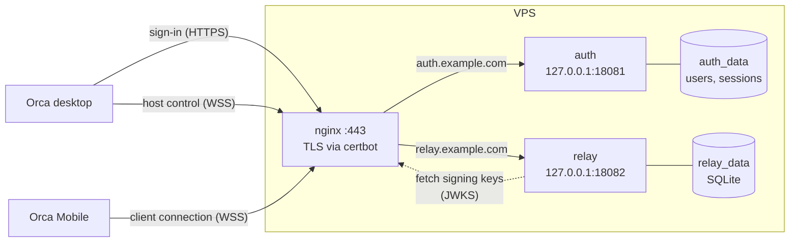
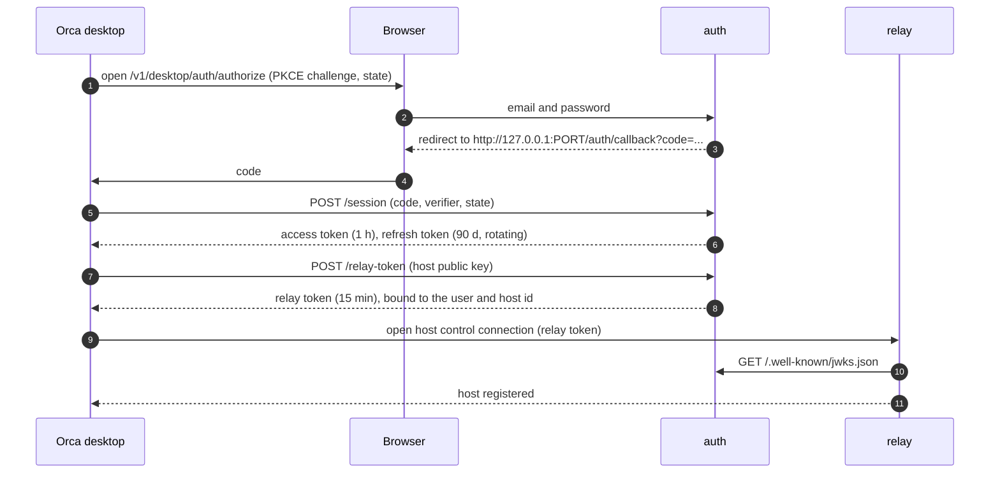
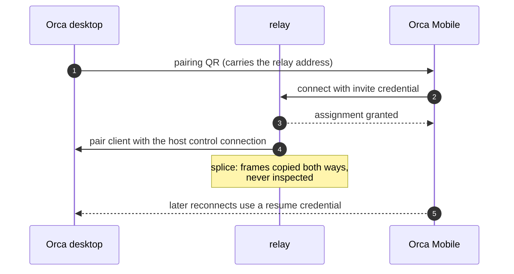

# Self-hosted Orca Mobile relay

Deployment files for running your own relay between the Orca desktop app and Orca Mobile, on
your own VPS, instead of Stably's hosted relay. Built for a team: every person signs in with
their own email and password.

- **Relay:** the official relay from [`stablyai/orca`](https://github.com/stablyai/orca)
  (`cloud/apps/relay`, MIT), built unmodified from a pinned release commit.
- **Sign-in:** a small service in this repo (`auth/`) that stands in for Orca Cloud's private
  sign-in. No dependencies, SQLite storage, per-user accounts, revocable sessions.
- **Edge:** the nginx and certbot that already run on the host.

## Scope and caveats

- **Orca Mobile pairing only.** It does not give `orca serve` a desktop-to-VPS relay route
  (upstream issue [stablyai/orca#22278](https://github.com/stablyai/orca/issues/22278)).
- **Unofficial.** It replaces Orca Cloud's private sign-in and relies on interfaces the Orca
  desktop app does not document. An Orca update can break it.
- **Push notifications** still go through Stably's gateway (it authenticates with the host's own
  key, not the sign-in).
- Share and team features of Orca Cloud are not available. Only relay access is granted.

## Architecture



| Component | Role |
|---|---|
| nginx + certbot | Existing host services. Terminate TLS and route by hostname. Not run by this repo's compose file. |
| `auth` | Sign-in service. Email and password page, PKCE code exchange, access tokens, rotating refresh tokens, and the short-lived ES256 relay tokens. Users and sessions live in SQLite. |
| `relay` | Official relay in `combined` mode (director and cell in one process), SQLite on a Docker volume. Pairs a host connection with a client connection and forwards frames between them. |
| `relay-init` | One-shot container that fixes ownership of the relay volume for the unprivileged relay user. |

Both services publish to `127.0.0.1` only. nginx is the only public entry point.

## How it works

### Sign-in and relay token



The auth service only redirects codes to the desktop's own loopback callback. Codes are single
use and expire after 5 minutes. The relay identifies a host by the pair (user id, host id), where
the host id is derived from the host's public key, so two people never share a relay identity.

### Pairing and traffic



The relay's forwarding code copies frames between the two sockets without reading them. The
encryption between phone and desktop is done by the Orca apps themselves, not by this repo.

### Refresh token rotation

Each refresh spends the old token and returns a new one. If the reply is lost, the desktop may
retry with the spent token within 60 seconds and gets a fresh successor. A spent token replayed
after that ends the whole sign-in, so a stolen refresh token cannot outlive the next legitimate
refresh.

## Requirements

- A Linux VPS with Docker (Compose v2), nginx, certbot with the nginx plugin, `envsubst`, and
  ports 80 and 443 reachable (cloud security group and OS firewall).
- Two DNS A records to the VPS, for example `auth.example.com` and `relay.example.com`, with no
  CDN or proxy in front.
- Region: a Hong Kong or Singapore VPS avoids the problems a mainland China VPS has with Docker
  Hub and GitHub (the build pulls `node:24-alpine` and `busybox`, clones the Orca repository and
  runs `pnpm install`). A domain on ports 80/443 in mainland China also needs an ICP filing.
- On the Mac: the Orca desktop app. The launcher script is macOS only.

nginx can keep serving other sites. This setup adds one file, `orca-relay.conf`, and touches no
other vhost.

## Deploy

All commands run on the VPS, from this repo's directory.

1. **DNS.** Create the two A records and wait until both resolve to the VPS.

2. **Generate secrets.**

   ```sh
   scripts/init-env.sh auth.example.com relay.example.com
   ```

   Writes `.env` (mode 600) with a fresh signing key and relay assignment key. Nothing is
   printed. Refuses to overwrite an existing `.env`.

3. **Build and start.**

   ```sh
   docker compose up -d --build
   ```

   The first build takes roughly 10 to 15 minutes. The relay image clones the Orca monorepo
   shallowly and runs `pnpm install`. On a shared host, prefix with `nice -n 15`.

4. **Add the nginx vhosts.**

   ```sh
   scripts/install-nginx.sh
   ```

   Substitutes domains and ports into `deploy/nginx.conf.template`, installs it as
   `/etc/nginx/sites-available/orca-relay.conf`, runs `nginx -t`, and reloads. If the test
   fails it removes the vhost and does not reload.

5. **Issue certificates.**

   ```sh
   sudo certbot --nginx -d auth.example.com -d relay.example.com --redirect
   ```

6. **Create the first user.**

   ```sh
   scripts/user.sh add alice@example.com --name "Alice"
   ```

   It prompts for a password (hidden, at least 12 characters). Use `--generate` to create one
   and print it once.

7. **Check.**

   ```sh
   curl -s https://auth.example.com/health            # {"ok":true}
   curl -s https://relay.example.com/ready            # {"ok":true}
   docker compose logs relay | grep '"ready":true'
   ```

   On first start the relay runs SQLite migrations for a minute or two, so it can answer 502
   or refuse connections briefly.

## Managing users

```sh
scripts/user.sh add <email> [--name "Display name"] [--generate]
scripts/user.sh list
scripts/user.sh passwd <email> [--generate]   # also ends that user's sessions
scripts/user.sh disable <email>               # blocks sign-in, ends every session
scripts/user.sh enable <email>
scripts/user.sh revoke <email>                # ends every session, keeps the account
scripts/user.sh remove <email>
```

`list` shows each user's status and number of live sessions.

A revoked or disabled user is signed out of the auth service immediately and cannot get new relay
tokens. A relay token already issued stays valid for up to 15 minutes, so an open connection can
outlast the revoke by that long.

Sign-in is throttled in memory: an address is blocked for the rest of a 15 minute window after 10
failures, and an account that fails more than 5 times makes each further attempt wait
progressively longer (capped at 15 minutes). The wait never becomes a permanent lock-out. The
counters reset when the container restarts.

## Use from the Mac

1. Quit Orca with Cmd+Q. Orca is single-instance and reads its environment only at launch.
2. From a Terminal outside Orca:

   ```sh
   scripts/orca-with-relay.sh https://auth.example.com https://relay.example.com
   ```

3. In the app, sign in to Orca Cloud. The browser opens your sign-in page. Use your own email
   and password.
4. Pair the phone from Orca Mobile as usual.

The script sets `ORCA_CLOUD_API_URL`, `ORCA_CLOUD_CLIENT_ID=orca-desktop` and `ORCA_RELAY_URL`.
Launching Orca any other way (Dock, Spotlight) goes back to Stably's Orca Cloud, and each switch
needs a fresh sign-in.

Each person uses their own desktop and account. A person with several desktops signs in on each
with the same account.

## Configuration

### `.env` (written by `scripts/init-env.sh`, git-ignored)

| Variable | Meaning |
|---|---|
| `AUTH_DOMAIN`, `RELAY_DOMAIN` | Public hostnames. Used for issuer and relay URLs. |
| `AUTH_SIGNING_KEY` | ES256 (prime256v1) PKCS#8 PEM on one line with literal `\n`. Signs all tokens. |
| `RELAY_ASSIGNMENT_SIGNING_KEY` | 64 hex characters. Signs relay assignments. |
| `AUTH_PORT`, `RELAY_PORT` | Optional loopback ports. Defaults 18081 and 18082. Set before `install-nginx.sh`. |
| `AUTH_ORG_NAME` | Optional name shown by Orca for the organization. Default `Orca Relay`. |

`.env.example` is the template. Never commit `.env`.

### Auth service environment

| Variable | Meaning |
|---|---|
| `AUTH_ISSUER` | Public auth origin. Must match the relay's `ORCA_RELAY_AUTH_ISSUER` exactly. |
| `AUTH_DATA_DIR` | Directory for `auth.sqlite`. `/data` in the container, on the `auth_data` volume. |
| `AUTH_CLIENT_ID` | OAuth client id the desktop sends. Default `orca-desktop`. |
| `AUTH_TRUST_PROXY` | `1` behind nginx: the client address is the last `X-Forwarded-For` entry. |

Passwords are stored as scrypt hashes. Refresh tokens are stored only as SHA-256 hashes.

### Relay settings fixed in `docker-compose.yml`

| Setting | Why |
|---|---|
| `ORCA_RELAY_AUTH_ISSUER`, `ORCA_RELAY_JWKS_URL` | Must be an HTTPS origin (loopback HTTP is the only exception) and match `AUTH_ISSUER` exactly. |
| `extra_hosts: AUTH_DOMAIN:host-gateway` | The relay fetches signing keys from the public auth URL. This resolves it to the host's nginx, so it does not depend on NAT hairpinning. |
| `ORCA_RELAY_DATA_DIR=/data/relay` | SQLite location, on the `relay_data` volume. |
| `ORCA_RELAY_ADMIN_AUDIENCE`, `ORCA_RELAY_DEPLOY_SERVICE_ACCOUNT` | Placeholders (`admin.invalid`). The relay's admin routes verify Google-issued tokens, so these stay unusable. |
| `logging` (10 MB x 3) | The relay logs metrics every few seconds. Without rotation Docker keeps them forever. |

## Operations

| Task | Command |
|---|---|
| Status | `docker compose ps` |
| Auth logs | `docker compose logs -f auth` |
| Relay logs | `docker compose logs -f relay` |
| Restart | `docker compose restart auth relay` |
| Stop | `docker compose down` (keeps the volumes) |
| Back up | Copy `.env`, and snapshot the `auth_data` volume (users and sessions). |
| Revoke everyone | Rotate `AUTH_SIGNING_KEY`: it invalidates every token. Or `scripts/user.sh revoke` per user. |

Useful log lines:

- Auth: `login_ok`, `login_failed` (email and address, never the password), `refresh_replay_revoked`.
- Relay: `assignment granted ... host=<id>`, `orca_relay_client_accept_completed` with
  `credentialKind: invite` or `resume`, and `orca_relay_host_control_rtt`.

### Upgrading

The relay build context pins a release tag of `stablyai/orca` plus its commit checksum: the tag
of the desktop version this was validated against (`v1.4.259`). The relay shares its wire contract with the
desktop and mobile apps, so move the pin together with Orca upgrades, not ahead of them:

1. Find the commit a release tag points to:
   `git ls-remote https://github.com/stablyai/orca.git 'refs/tags/v<version>^{}'`.
2. In the `relay` build context of `docker-compose.yml`, set `tag=` to the new tag and
   `checksum=` to that commit. BuildKit refuses to build if the tag stops pointing at it.
3. `docker compose up -d --build relay`, then check the relay log for `"ready":true`.
4. Sign in on a desktop and pair a phone before rolling it out to the team.

## Troubleshooting

| Symptom | Likely cause |
|---|---|
| `init-env.sh` says `.env exists` | Intentional. Delete it only if you mean to rotate secrets. |
| 502 from the relay hostname right after start | First-start migrations. Wait a minute or two and check `docker compose logs relay`. |
| Relay exits with `ORCA_RELAY_AUTH_ISSUER must use HTTPS` | The issuer is not an HTTPS origin or has a path. Use `https://auth.example.com` exactly. |
| Relay never reports `"ready":true` | It cannot fetch `https://<auth-domain>/.well-known/jwks.json`. Check DNS, the certificate, and that the auth vhost is installed. |
| Relay cannot write its database | `relay-init` did not run. Run `docker compose up -d` again and check `docker compose logs relay-init`. |
| `certbot` fails the challenge | DNS has not propagated, or port 80 is blocked by the cloud security group or OS firewall. |
| Orca still signs in to Orca Cloud | It was not started through `scripts/orca-with-relay.sh`. Quit it fully and relaunch. |
| "Wrong email or password" for a correct login | The account is disabled, or the email differs. Check `scripts/user.sh list`. |
| "Too many attempts" | Throttling. Wait out the delay, or restart `auth` to clear the counters. |
| Phone needs to pair again after an upgrade | Relay identities are per user. Pair again after changing users or wiping `relay_data`. |

## Limits

- Throttling counters are in memory and reset on restart.
- The auth service speaks plain HTTP. It must stay behind TLS, as it is here (nginx, bound to
  loopback).
- Every user is a member of one organization. There are no roles beyond who has an account.
- The setup depends on undocumented Orca desktop interfaces.

## Development

```sh
cd auth
npm test        # Node 24, no dependencies
```

The tests cover the PKCE exchange, relay token claims, per-user isolation, refresh rotation and
replay handling, throttling, and revocation.

## Repository layout

| Path | Purpose |
|---|---|
| `docker-compose.yml` | `auth`, `relay-init` and `relay`, loopback ports, volumes, log rotation. |
| `auth/` | The sign-in service: `server.mjs`, `admin.mjs`, `src/`, `test/`, `Dockerfile`. |
| `deploy/nginx.conf.template` | nginx vhosts for both hostnames (HTTP bootstrap; certbot adds TLS). |
| `scripts/init-env.sh` | Create `.env` with fresh secrets. |
| `scripts/install-nginx.sh` | Install the nginx vhosts and reload nginx. |
| `scripts/user.sh` | Manage users in the running auth container. |
| `scripts/orca-with-relay.sh` | macOS launcher that points Orca at your auth and relay. |
| `.env.example` | Variable template with blank secrets. |
